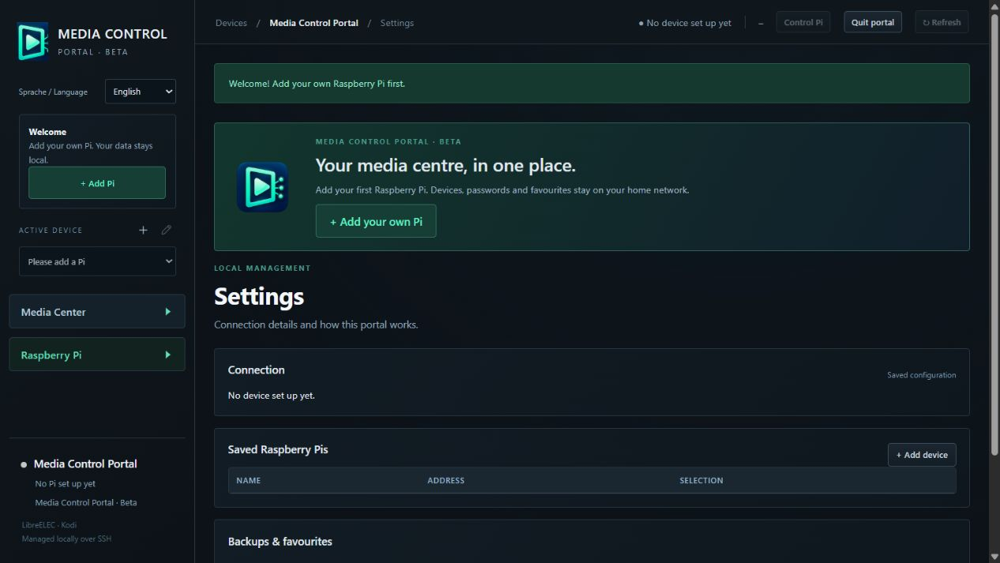

# Media Control Portal

A local Windows portal for managing your own LibreELEC/Kodi Raspberry Pis. German and English interface.

[Download the Windows beta](https://github.com/DavidRitter-design/media-control-portal/releases/tag/v0.1.0-beta) · [Report an issue](https://github.com/DavidRitter-design/media-control-portal/issues/new/choose) · [Deutsch](README.md)

## Features

Multiple device profiles; TV/video favourites, rename/delete and additive transfers between devices; source browsing with bulk selection and duplicate detection; playback and remote choices; Kodi 21 buffering settings; system information, read-only diagnostics and a Pi-side internet speed test.

## Install

Download **MediaControlPortal-0.1.0-beta-windows-x64.zip** from Releases, extract the entire archive into a writable folder, then start **Media Control Portal.exe**. Python and the required dependencies are included. The automatic GitHub source archives contain documentation, not the application.

Initial target: Windows 10/11 x64, LibreELEC, Kodi 21+, enabled SSH and Kodi JSON-RPC locally reachable on the Pi (default 9090). Separate TV/video home menu entries require Estuary. Other operating systems and skins are not supported in this beta. Add your own Pi and verify its SSH fingerprint before saving.

The launcher is unsigned. Testing used a clean extracted folder on the development computer; a separate fresh Windows machine and all hardware combinations have not been tested. Back up first.

## Privacy and contents

Localhost-only helper, no cloud account, telemetry or automatic updates. Stored SSH passwords use Windows DPAPI for the signed-in user. The speed test contacts Cloudflare when started; artwork may use image servers referenced by Kodi. No streams, media add-ons, channel lists or repositories are included. Provider-specific global search is excluded. Never redistribute a used installation folder containing device profiles and backups.

## License and feedback

Free beta with closed application code, for use with your own devices. This repository contains documentation and downloads, not the original backend source. See [testing terms](NUTZUNGSBEDINGUNGEN.md). Included third-party libraries retain their independent rights; license texts and source archives are in the download. The application is not MIT-licensed.

Publisher account: [DavidRitter-design](https://github.com/DavidRitter-design). Contact and feedback: [GitHub Issues](https://github.com/DavidRitter-design/media-control-portal/issues). Never post passwords, device profiles or unredacted logs. Independent project, not an official Kodi, LibreELEC or Raspberry Pi product.
