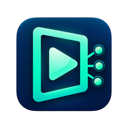
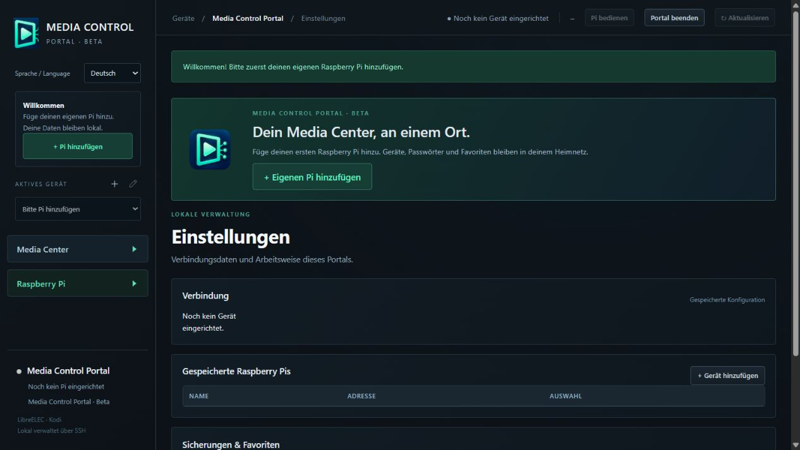

# Media Control Portal

**Mehrere Kodi-Pis bequem vom Windows-PC verwalten.**

Favoriten aufräumen, Quellen durchsehen und Einstellungen deiner eigenen LibreELEC-Geräte an einer Stelle bedienen. Das Portal läuft lokal auf deinem PC und verbindet sich per SSH mit deinen Pis.

[Windows-Beta herunterladen](https://github.com/DavidRitter-design/media-control-portal/releases/tag/v0.1.0-beta) · [English](README.en.md) · [Fehler melden](https://github.com/DavidRitter-design/media-control-portal/issues/new/choose)

## Funktionen

- Mehrere Geräte anlegen, benennen und wechseln; Deutsch und Englisch.
- TV- und Videofavoriten pflegen, umbenennen und mit Bestätigung löschen.
- Fehlende Favoriten gezielt zwischen eigenen Pis übertragen, getrennt nach TV und Video.
- Installierte Quellen durchsuchen und mehrere Einträge einer Seite als Favoriten übernehmen; vorhandene Einträge erkennen.
- Wiedergabe am Pi starten und weitere Kodi-Auswahlfenster im Portal bedienen.
- Kodi-21-Cache-Einstellungen mit Sicherung und Rückprüfung ändern.
- Systeminfos, lesende SSH-Diagnose, Dateivorschau und Internet-Speedtest direkt auf dem Pi.

## Download und Einrichtung

1. Unter [Releases](https://github.com/DavidRitter-design/media-control-portal/releases/tag/v0.1.0-beta) **MediaControlPortal-0.1.0-beta-windows-x64.zip** laden. Die automatisch angebotenen „Source code“-Archive enthalten nur diese Projektunterlagen, nicht das Programm.
2. Das ZIP vollständig in einen eigenen beschreibbaren Ordner entpacken.
3. **Media Control Portal.exe** starten. Die nötige Laufzeit ist enthalten; Python muss nicht separat installiert werden.
4. **Pi hinzufügen** wählen, eigene SSH-Zugangsdaten eingeben, Verbindung und SSH-Fingerabdruck prüfen und speichern.

**Voraussetzungen:** Windows 10/11 x64, Raspberry Pi mit LibreELEC, Kodi 21+ und aktiviertem SSH. Kodi-JSON-RPC muss auf dem Pi lokal erreichbar sein (Standardport 9090). Die zusätzlichen TV-/Video-Hauptmenüpunkte setzen Estuary voraus. Andere Betriebssysteme und Skins sind in dieser Beta nicht freigegeben.

**Beta-Status:** Der Windows-Starter ist nicht signiert. Getestet wurden eine saubere entpackte Programmstruktur auf dem Entwicklungsrechner, die Ersteinrichtung und technische Schutzfunktionen. Ein separater frischer Windows-PC und sämtliche Gerätekombinationen sind noch nicht getestet. Vor Änderungen eigene Sicherungen anlegen.

## Datenschutz und Inhalte

Keine Cloudkonten, Telemetrie oder automatischen Updates. Der lokale Helfer lauscht ausschließlich auf 127.0.0.1; kein Portforwarding erforderlich. SSH-Passwörter werden unter Windows mit DPAPI für deinen Windows-Benutzer verschlüsselt gespeichert. Der Speedtest kontaktiert nach deinem Klick Cloudflare; Vorschaubilder können die von Kodi angegebenen Bildserver abrufen.

Enthält keine Streams, Senderlisten, Repositories, TV-Logos oder Video-Add-ons. Die Beta verwendet Kodis allgemeine Quellenansicht; eine anbieterspezifische globale Suche ist nicht enthalten. Geräteprofile, Protokolle und Sicherungen bleiben lokal. Einen bereits verwendeten Programmordner nicht weitergeben.

## Feedback

Bitte [Fehler](https://github.com/DavidRitter-design/media-control-portal/issues/new/choose) mit Windows-/Kodi-Version, nachvollziehbaren Schritten und gegebenenfalls geschwärzten Screenshots melden. Keine Passwörter, Geräteprofile, privaten Links oder vollständigen Protokolle veröffentlichen. Verbesserungsvorschläge sind willkommen.

## Nutzungsrechte und Projektkontakt

Kostenlose Beta mit geschlossenem Anwendungscode. Dieses Repository dient für Downloads, Dokumentation und Feedback; es veröffentlicht nicht den eigenen Backend-Quellcode. Die [Testnutzungsbedingungen](NUTZUNGSBEDINGUNGEN.md) erlauben die Nutzung auf eigenen Geräten. Eigenständige Rechte der mitgelieferten Fremdbibliotheken bleiben bestehen; deren Lizenztexte und Quellen liegen im Download. Eine MIT-Lizenz wird für die eigene Anwendung nicht erteilt.

Veröffentlicht über das GitHub-Konto [DavidRitter-design](https://github.com/DavidRitter-design). Projektkontakt: [GitHub Issues](https://github.com/DavidRitter-design/media-control-portal/issues). Derzeit kostenlos, ohne Kauf oder Spendenpflicht.

Unabhängiges Projekt; kein offizielles Produkt von Kodi, LibreELEC oder Raspberry Pi und keine behauptete Unterstützung durch diese Projekte.

